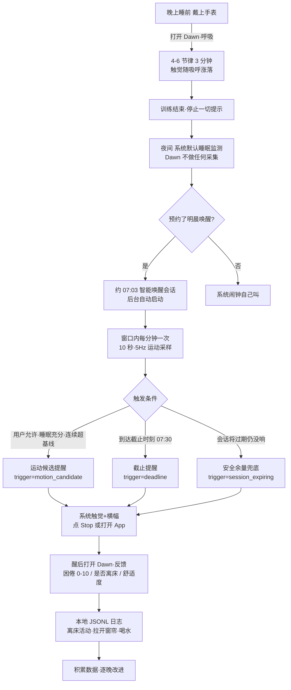

# Dawn 产品设计文档

版本：V0.1 · 2026-11-03 · 对应工程实现见 [SPEC](SPEC.md)

---

## 1. 构想与目标

### 1.1 构想

> 让手腕完成一个低打扰的日常闭环：**夜间放松 → 短时感知 → 清晨唤醒 → 晨间激活 → 反馈改进**。

Apple Watch 已经替你记录了睡眠，但它只负责"记录"，不参与"入睡"和"起床"这两个最难的瞬间。Dawn 只在这两个瞬间出手：

- **睡前**：3 分钟温和触觉呼吸，帮你从一天的节奏里降下来；
- **清晨**：一段最长 27 分钟的智能唤醒窗口，腕部运动信号 + 截止时刻，用系统级触觉把你叫醒；
- **醒后**：10 秒记录困倦感和离床状态，攒下属于你自己的数据。

三条红线贯穿始终：**不做医疗诊断、不宣称识别睡眠分期、不整夜常开传感器。** "智能"的前提是诚实——没有可靠证据时，就到截止时刻准时叫你，绝不瞎猜。

### 1.2 第一阶段（MVP V0.1）目标

在 Apple Watch Ultra 2 上验证四件事，全部达标才算进入下一阶段：

| # | 目标 | 验证方式 |
|---|---|---|
| 1 | 原生 App 能装进手表、独立打开 | Xcode 真机安装 |
| 2 | 前台呼吸训练可用（4-6 默认 / 4-7-8 初学限 4 周期） | 手表实际跟练 |
| 3 | Smart Alarm 真的能在后台按预约触发系统触觉 | 短间隔试响 + 连续 20 次无漏响 |
| 4 | 窗口内运动采样可用（数据、缺口、耗电可量化） | 本地实验日志导出 |

第一阶段**不追求**：识别睡眠阶段、自动提前唤醒默认开启、iPhone 配套 App、任何云端能力。

---

## 2. 用户旅程

### 2.1 一日流程图

### 2.2 用户旅程叙述

**晚上 23:40** —— Murphy 上了床，抬腕点开 Dawn，选"4-6、3 分钟"。圆环随节律涨缩，腕上轻拍：吸气一下、呼气一下。屏幕暗了就停，不假装还在引导。练完躺下。

**夜里** —— 手表用系统自带的睡眠监测。Dawn 一个字节都不采。预约过明晨唤醒的话，07:03 系统会自动拉起 Dawn 的唤醒会话。

**清晨 07:03–07:30** —— 会话开始，每分钟取一个 10 秒的运动观察窗口（5Hz 加速度，共约 50 个样本），和今晚自己的基线比。默认情况下 Dawn 不做任何提前，安静等到 07:30 准时触觉提醒；只有用户显式打开"允许提前唤醒"、且睡眠数据充分、且连续窗口显著超基线，才提前。任何情况下，会话到期前 90 秒有兜底提醒——**不会白占会话却不响**。

**醒后 07:31** —— 点横幅打开 App，反馈页三个输入：困倦几分、离床没、训练舒服吗。10 秒存进本地日志。首页能看到最近的事件流水。

### 2.3 功能点对照（F01–F08）

| ID | 功能 | 用户看到什么 |
|---|---|---|
| F01 | 原生安装 | 表盘上出现 Dawn 图标，可独立打开 |
| F02 | 两种呼吸 | 4-6（3/5 分钟）与 4-7-8（初学 4 周期约 76 秒），可暂停/结束，相位触觉 |
| F03 | 健康只读 | 最近 7 晚各分期分钟数 + 最新心率/呼吸频率 + **采样时间**（强调"是历史记录非实时"） |
| F04 | 试响闹钟 | 2/3/5 分钟后真实后台触发系统触觉——验证能力，不是演示动画 |
| F05 | 明晨唤醒 | 设截止钟点（默认 07:30），预约 27 分钟窗口，状态全程可查 |
| F06 | 运动采样 | 每窗口的样本数 / P50/P95 实际间隔 / 缺口 / 变异性写入日志 |
| F07 | 安全降级 | 缺授权、缺数据、会话出错 → 明确提示 + 建议保留系统闹钟保底 |
| F08 | 晨间反馈 | 困倦/舒适 0–10、离床状态，可查最近 7 条 |

---

## 3. 产品取舍

| 取舍 | 选择 | 放弃 | 为什么 |
|---|---|---|---|
| 后台模式 | `alarm`（Smart Alarm） | `mindfulness`（呼吸后台续跑） | watchOS 每个 App 只能配一种扩展运行模式。闹钟是核心价值；呼吸关屏即停，如实呈现 |
| 唤醒窗口 | 27 分钟 | 30 分钟顶格 | 系统上限 30 分钟，两端各留 90 秒安全余量，保证"截止后仍响得了 + 到期前必有兜底" |
| 提前唤醒 | **默认关**（P1 实验开关） | 默认开、炫"智能" | 误早醒的代价远大于晚醒 10 分钟；运动候选必须同时满足"用户允许+睡眠充分+连续超基线"，且文案永远写"运动候选"，不写"识别浅睡眠" |
| 传感策略 | 窗口内突发采样（10s/60s @5Hz） | 整夜常开采集 | 耗电与可靠性不可接受；夜间完全依赖系统睡眠监测 |
| 健康数据 | 只读、只在设备本地 | 写入/上传/第三方分析 | 一个晨间工具没有资格改你的健康数据 |
| 触觉 | 系统 haptic 类型 | 自定义振动波形 | API 不开放自定义；系统类型经过 Apple 打磨，够用 |
| 配套端 | V0.1 纯手表 | iPhone App / 云端 / 账号 | 最小可验证闭环先跑通；WatchConnectivity 是 V0.2 的事 |
| 判定证据 | 4 种触发原因显式记录 | 模糊的"智能唤醒"话术 | 防止把"技术成功"混淆为"健康收益"；实验可复盘 |
| 失败处理 | 原样记录错误 + 保底提示 | 静默降级到普通计时器冒充闹钟 | 宁可诚实失败，不可虚假成功——这是全部信任的根基 |

---

*本文档随版本迭代更新；工程粒度的约束见 [SPEC](SPEC.md)，验收关卡见 [TEST_PLAN](TEST_PLAN.md)。*
